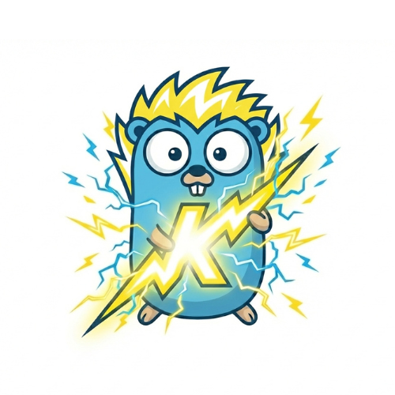

# KVolt

<p align="center">
  
</p>

<p align="center">
  <a href="https://github.com/go-kvolt/kvolt/actions/workflows/ci.yml"></a>
  <a href="https://pkg.go.dev/github.com/go-kvolt/kvolt/v2"></a>
  <a href="https://goreportcard.com/report/github.com/go-kvolt/kvolt"></a>
  <a href="https://github.com/go-kvolt/kvolt/blob/main/LICENSE"></a>
  <a href="https://github.com/go-kvolt/kvolt"></a>
  <a href="https://github.com/go-kvolt/kvolt/releases"></a>
</p>

**KVolt** is a Go web framework on `net/http`: a fast radix router, a familiar context API, and production middleware — with optional Redis, Prometheus, and gRPC as separate imports so the core stays lean.

Module: [`github.com/go-kvolt/kvolt/v2`](https://pkg.go.dev/github.com/go-kvolt/kvolt/v2) · Requires **Go 1.27+** · [Changelog](CHANGELOG.md)

---

## Quick start

```go
package main

import (
	"log"

	"github.com/go-kvolt/kvolt/v2"
	"github.com/go-kvolt/kvolt/v2/context"
	"github.com/go-kvolt/kvolt/v2/middleware"
)

func main() {
	app := kvolt.Default() // Recovery, Request-ID, 1MB body limit
	app.Use(middleware.Logger())

	app.GET("/ping", func(c *context.Context) error {
		return c.JSON(200, map[string]string{"message": "pong"})
	})

	log.Fatal(app.Run(":8080"))
}
```

```bash
go get github.com/go-kvolt/kvolt/v2@latest
go run .
# → http://localhost:8080/ping
```

---

## Install

**Library**

```bash
go get github.com/go-kvolt/kvolt/v2@latest
```

**CLI** (scaffold + hot reload)

```bash
go install github.com/go-kvolt/kvolt/v2/cmd/kvolt@latest
kvolt new my-app
cd my-app && go mod tidy && go run ./cmd/api
```

If `kvolt` is not found: `export PATH="$PATH:$(go env GOPATH)/bin"`

---

## Why KVolt

| | KVolt |
| :--- | :--- |
| Core | `net/http` engine, radix router, `Context` helpers, graceful shutdown |
| Defaults | `kvolt.Default()` — recovery, request ID, body size limit |
| Security | CSRF, Secure headers, JWT, BasicAuth/APIKey, trusted-proxy `ClientIP`, safe redirects/uploads |
| Batteries | Config, DI, validation, sessions, cache, queue, scheduler, OpenAPI/Scalar |
| Optional deps | Redis cache/queue, Prometheus, gRPC — imported only when you need them |

Compared to Gin/Echo/Fiber: similar routing ergonomics, with more built-ins in-tree and heavier integrations kept out of the default import graph.

---

## Features

- **Router** — params (`/users/:id`), static suffixes after params, wildcards, groups, trailing-slash / 405 helpers
- **Middleware** — Logger, Recovery, RequestID, Timeout, CORS, Gzip, Limiter, CSRF, Secure, JWT / JWTOptional, Metrics
- **APIs** — JSON bind/validate, `httperr`, cookies, SSE, WebSockets, file uploads (`SafeUploadPath` / `FileFrom`)
- **Docs** — OpenAPI from routes + Scalar UI
- **Jobs** — in-memory queue; Redis at-least-once queue (`pkg/queue/redis`)
- **Cache** — sharded memory store; Redis store (`pkg/cache/redis`)
- **gRPC** — `grpc.Attach` / `RunDual` alongside HTTP
- **DX** — `kvolt` CLI, templates, `pkg/test` / `pkg/testkit`

Full list and guides: **[Documentation](docs/index.md)**

---

## Examples

| Example | Description |
| :--- | :--- |
| [`example/full_app`](example/full_app) | Middleware, JWT, queue, Prometheus, OpenAPI |
| [`example/queue_app`](example/queue_app) | Background jobs |
| [`example/grpc_app`](example/grpc_app) | HTTP + gRPC dual serve |

---

## Documentation

- [Getting started](docs/getting_started.md)
- [Routing](docs/router.md) · [Context](docs/context.md) · [Middleware](docs/middleware.md)
- [Authentication](docs/authentication.md) · [Errors](docs/errors.md) · [SSE](docs/sse.md)
- [Caching](docs/caching.md) · [Queue](docs/queue.md) · [gRPC](docs/grpc.md)
- [Testing](docs/testing.md) · [Benchmarks](docs/benchmarks.md) · [CLI](docs/cli.md)
- [Full index](docs/index.md) · [pkg.go.dev API](https://pkg.go.dev/github.com/go-kvolt/kvolt/v2)

---

## Binding example

```go
app.POST("/users", func(c *context.Context) error {
	var u struct {
		Name  string `json:"name" validate:"required"`
		Email string `json:"email" validate:"required,email"`
	}
	if err := c.Bind(&u); err != nil {
		return err // maps to JSON via httperr / WriteHandlerError
	}
	return c.JSON(201, u)
})
```

---

## Development

```bash
go test ./...
./scripts/local10.ps1   # fmt, vet, race, soak, fuzz (needs gcc on Windows)
./scripts/bench.ps1     # microbenchmarks
```

See [CONTRIBUTING.md](CONTRIBUTING.md).

---

## Benchmarks

Reproducible **in-process** microbenchmarks (not network Req/Sec). Methodology: [docs/benchmarks.md](docs/benchmarks.md).

```bash
./scripts/bench.ps1
```

Sample (`go1.27.3`, Windows/amd64, Intel Core Ultra 7 155H) — run on your machine for authoritative numbers:

| Benchmark | ns/op | allocs/op | ≈ ops/sec |
| :--- | ---: | ---: | ---: |
| `BenchmarkEngine_Ping` | ~114 | 2 | ~8.7M |
| `BenchmarkEngine_PingParallel` | ~50 | 2 | ~20M |
| `BenchmarkEngine_JSON` | ~2.2µs | 6 | ~460k |
| `BenchmarkEngine_Param` | ~407 | 2 | ~2.5M |
| `BenchmarkEngine_DefaultPing` | ~1.3µs | 9 | ~780k |
| `BenchmarkRouter_Static` | ~16 | 0 | ~63M |
| `BenchmarkRouter_Param` | ~50 | 1 | ~20M |

For end-to-end HTTP throughput, load-test a live `app.Run` with `wrk` or `hey`.

---

## License

[MIT](LICENSE)

Created & maintained by Kaviraj Mani
